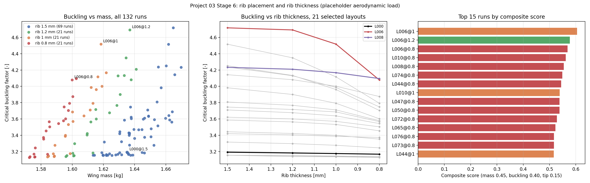
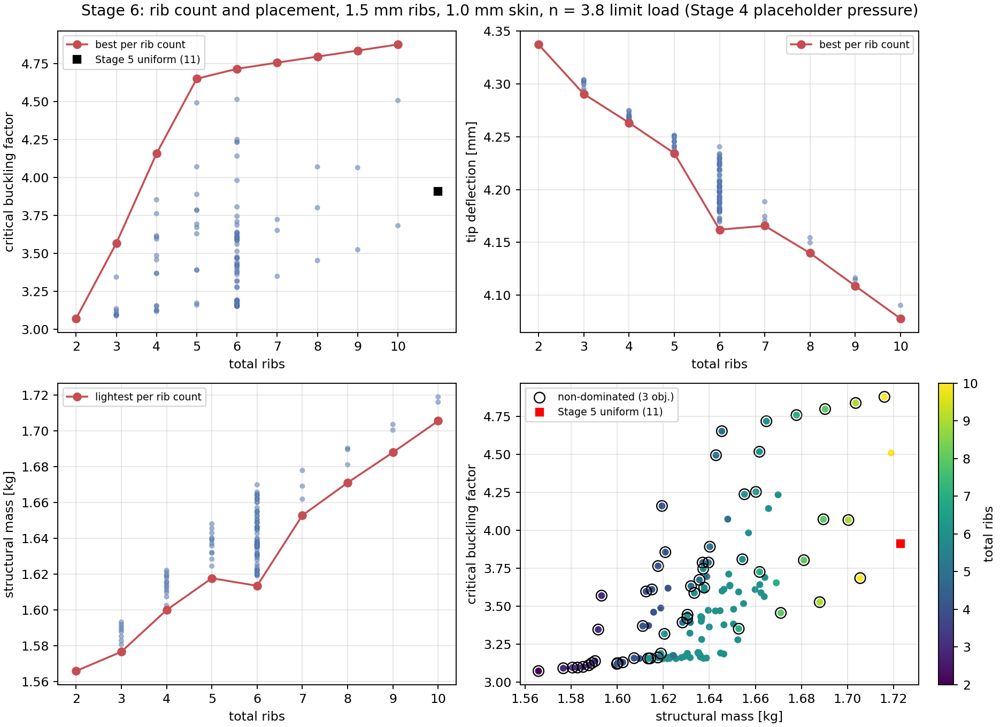
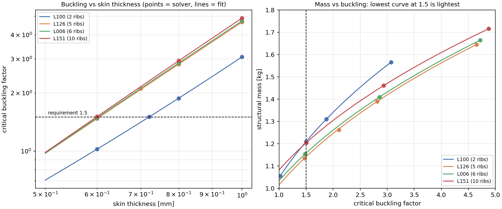
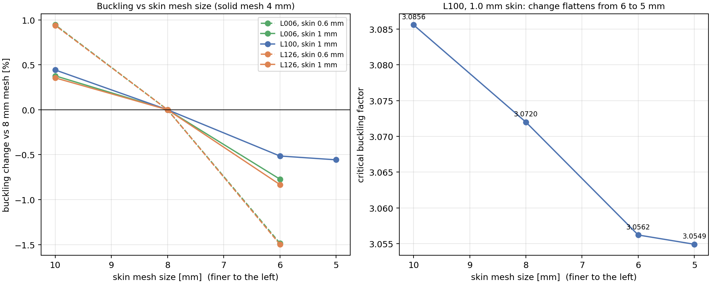
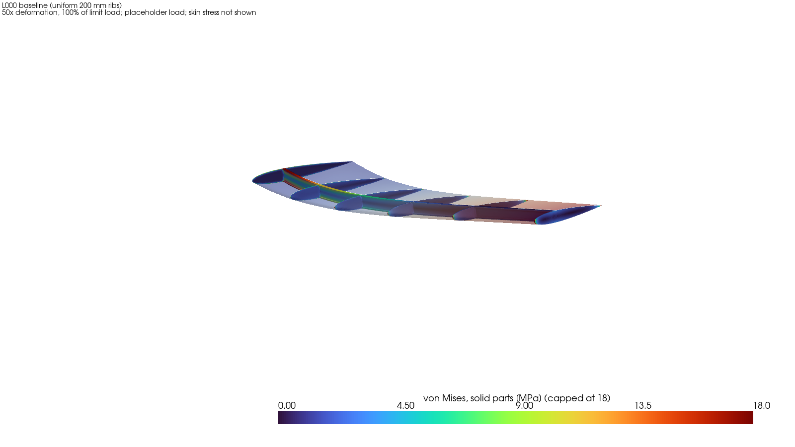
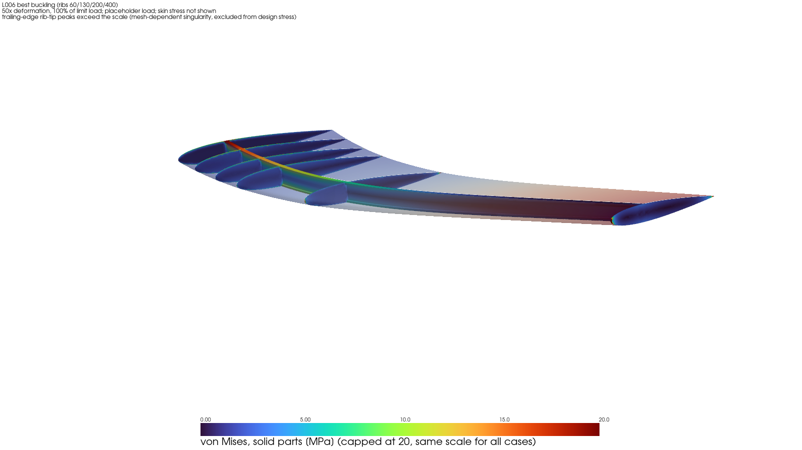
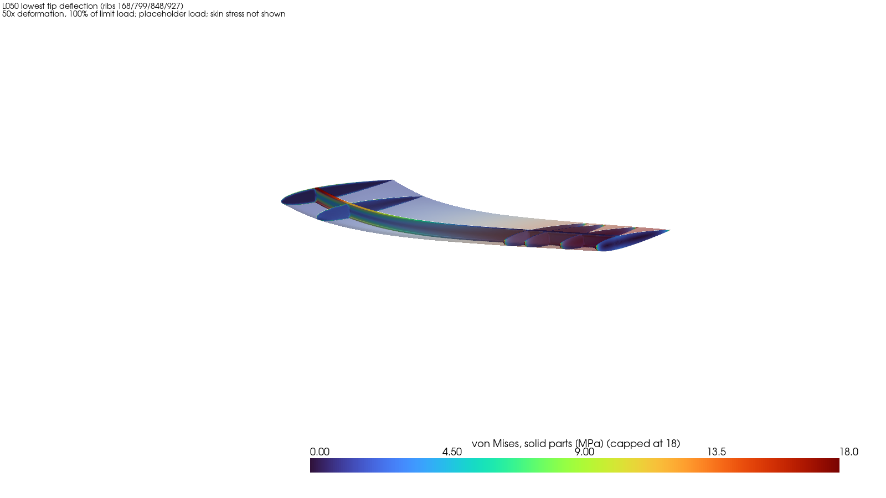

# Project 03: UAV Wing Structural Analysis

**Rib layout, rib count, rib thickness and skin gauge of a tapered aluminium UAV wing under a 3.8 g limit load.** A staged finite-element study built with CalculiX, Netgen and Python.

Status: computational study complete. Results are **verified (no validation against experiment)** and use an **analytic placeholder pressure, not CFD**; the aircraft mass, the yield stress and the load factor are stated assumptions (section 2).

## Summary

A half-wing (NACA 0012, root chord 300 mm, tip chord 150 mm, 1 m span) with a spar, ribs and a closed aluminium skin is analysed in six stages, from a verified spar-only model to a parametric study of 121 rib layouts run through an automated geometry, mesh, solve and extraction pipeline. The question is how rib spacing, placement, count and thickness, and skin gauge, change the buckling margin, tip deflection and mass.

| Finding | Result |
|---|---|
| Baseline (uniform 200 mm ribs, 6 ribs, 1.0 mm skin) | buckling factor 3.19, tip deflection 4.20 mm, mass 1.635 kg |
| Best six-rib placement (ribs at 0, 60, 130, 200, 400, 1000 mm) | buckling 4.72 (+48%) for +1.8% mass |
| Rib count | the buckling gain saturates near five ribs (about 0.5 per rib below, about 0.04 per rib above) |
| Skin gauge | about 1.28 kg per mm of skin (74–82% of structural mass); buckling scales as t^2.1–2.3; a factor of 1.5 is reached at about 0.6–0.72 mm skin depending on the layout |
| Stress | not binding: skin p99 below 32 MPa; the largest solid stress away from the trailing edge and root is about 62 MPa (three layouts checked), against an assumed yield of 290 MPa |
| Mesh | tip deflection converged (changes of 0.01% or less); buckling at the baseline mesh is about 0.5–1.5% unconservative; convergence not demonstrated |

## 1. Research question and scope

How do rib configuration (spacing, then non-uniform placement and count) and skin gauge affect a tapered UAV wing's tip deflection, skin buckling resistance, structural margin and mass under a combined self-weight and elliptical aerodynamic load, starting from a verified spar-to-skin structural model?

In scope: linear static stress and deflection, linear eigenvalue buckling, mass, and mesh sensitivity. Out of scope: CFD-derived loads (Project 04), dynamics, imperfections and post-buckling, composites, fasteners, and validation against test data.

## 2. Model and assumptions

**Geometry.** NACA 0012, tapered planform (root chord 300 mm, tip chord 150 mm), half-span 1000 mm, spar at 30% chord, ribs 1.5 mm thick with the true airfoil outline (baseline: six ribs at 200 mm spacing).

**Material.** Al 2024-T3 for spar, ribs and skin: E = 73,100 MPa, nu = 0.33, rho = 2780 kg/m^3.

**Spar.** Stages 1–2 used a spar 80% as deep as the local airfoil. Stage 3 found a 3.6 mm (root) to 1.8 mm (tip) gap between spar caps and skin, so the spar was redesigned ("spar v2": full airfoil depth, 2 mm web, 8 x 3 mm caps, +30 g). Spar position and dimensions are then held fixed for the project. Stage 1–2 results describe the earlier spar and serve as the verified baseline of the pipeline.

**Skin.** A closed airfoil skin of shell elements sharing nodes with the solid ribs and spar caps along their contact lines (conformal mesh). CalculiX's `*TIE` does not support shell elements, so no tie constraints are used.

**Loads.** Stages 1–2: self-weight plus a 24.5 N elliptical lift (5 kg aircraft, n = 1), an explicit placeholder. From Stage 3: limit load at n = 3.8 with an assumed 20 kg aircraft, giving a half-wing elliptical lift of 372.78 N, plus self-weight x 3.8. From Stage 4 the lift is applied as an analytic pressure on the skin: elliptical in span, thin-airfoil flat-plate in chord (centre of pressure at 25% chord, 5% chord ahead of the spar), split antisymmetrically between upper suction and lower pressure.

**Requirements at limit load.** Von Mises stress at most yield / 1.5, and a linear buckling factor of at least 1.5.

| Input | Value | Basis |
|---|---|---|
| Aircraft mass | 20 kg | assumption, not from a standard |
| Limit load factor | 3.8 | cap in 14 CFR 25.337(b); the UAV-specific standard text (STANAG 4671 / CS-23) was not consulted |
| Yield stress | 290 MPa | assumed, uncited |
| Material constants | as above | literature values, not checked against a primary source |
| Pressure distribution | analytic | placeholder, not an aerodynamic prediction |

The analysis is linear, so the buckling factor scales roughly as 1 / load. The 1.0 mm skin passes for aircraft up to about 40 kg and a 0.5 mm skin only up to about 12 kg; the selected gauge is valid for the 20 kg assumption only.

## 3. Method

**Toolchain.** Geometry and boolean imprint with Gmsh/OpenCASCADE scripts; Netgen meshing (second-order tetrahedra C3D10 for solids, S6 shells for the skin); CalculiX 2.23 for static and linear buckling solves; Python (NumPy, SciPy, Matplotlib, PyVista) for extraction, analysis and figures. Units are mm, N, s, tonne, MPa.

**Baseline mesh.** Solid 4 mm, skin 8 mm. The machine has 11 GB of RAM, so runs are limited by a 230,000-element ceiling, an equation-count estimate gate and an 8 GB memory watchdog.

**Metrics.**
- Critical buckling factor: multiplier on the whole limit load.
- Tip deflection on the spar axis, and structural mass.
- Skin p99 von Mises stress (the primary stress metric).
- Design skin stress: the maximum von Mises over skin nodes at least 3 mm from the trailing edge and 10 mm from the fixed root (mesh-sensitive, see section 5.2).

**Parametric driver.** `scripts/run_layout_study.py` runs each case through one chain: geometry, imprint of the skin faces, mesh, static solve, buckling solve, extraction. A layout is a list of rib stations from root (0) to tip (1000 mm). Layouts whose imprint produces a sliver face below a gate (free piece 5 mm^2, shared piece 0.5 mm^2) are rejected rather than meshed; the thresholds are provisional.

**Stages.**
1. Spar alone.
2. Spar and ribs (200 mm).
3. Spar v2, ribs and skin: skin gauge selection and buckling.
4. Lift applied as pressure on the skin.
5. Rib spacing, 200 mm against 100 mm (reduced scope).
6. Rib layout, rib count, rib thickness, skin gauge and skin-mesh sensitivity.

## 4. Verification (no validation)

Verification asks whether the mathematical model was solved correctly. No result here is validated against experiment or published test data.

- **Stage 1 (spar):** tip deflection and flange stress agree with tapered beam theory to better than 0.25% on two mesh levels.
- **Stage 2 (ribs):** tip deflection agrees with a beam reference that treats ribs as point weights to 0.12%.
- **Stage 3 (skin):** results at n = 1 and n = 3.8 superpose exactly; tip deflection agrees with a tapered beam with a fully effective skin ring within 0.8%, -0.4% and -3.1% at 0.5, 1.0 and 1.5 mm (an approximate reference, not a bound); the critical buckling stress (32.5 MPa) agrees with simply supported flat-plate theory for the buckle's own width (31.6 MPa) to 2.7%, a plausibility check.
- **Stage 4 (pressure):** the load was recomputed independently from the written input files before any solve: net force within 0.003%, root moment within 0.0002%, chordwise centre of pressure 0.249–0.251 in every span bin. Lift-only plus gravity-only reproduces the full case to 1 nm.
- **Stage 6 (parametric study):** the baseline layout reproduces the Stage 4 result, and every layout re-run in later checks reproduced its stored result exactly. The skin-gauge fit was tested by two intermediate solves (buckling within 1.3%, tip and mass within 0.1%).
- **Mesh sensitivity:** section 5.6.

## 5. Results

### 5.1 Spar and ribs (Stages 1–2)

| | 2.0 mm mesh | 2.5 mm mesh |
|---|---|---|
| Spar-axis tip deflection (spar + ribs) | 3.679 mm | 3.679 mm |
| Against beam reference | -0.12% | -0.11% |
| Flange stress against beam theory | within 0.06% | within 0.06% |

The ribs add weight, not bending stiffness: tip deflection fell 4.2% (3.841 to 3.679 mm), and the ribs' added self-weight alone predicts 4.25%. The ribs cost +108 g (+49% mass). Their structural value has to come from the skin.

### 5.2 Skin gauge selection (Stage 3)


Limit load, 200 mm ribs, 20 kg aircraft and 290 MPa yield assumed:

| Skin | Skin mass | Tip deflection | Buckling (needs 1.5) | Design skin stress | Result |
|---|---|---|---|---|---|
| 0.5 mm | 0.64 kg | 8.36 mm | 0.91 | 39.4 MPa | fails buckling |
| **1.0 mm** | 1.28 kg | 4.20 mm | **3.14** | 34.2 MPa | passes; selected |
| 1.5 mm | 1.92 kg | 2.52 mm | 8.61 | 25.3 MPa | passes, 50% heavier |


The critical mode at 1.0 mm is a single local buckle of the upper skin aft of the spar in the root bay; all six computed modes, at every thickness, are upper-skin, aft-of-spar, out-of-plane buckles in the two root bays.

**The trailing-edge stress peak is a singularity of the model.** The largest skin stress (238 MPa at 1.0 mm) sits at the trailing-edge vertex at the ribs. Refining the mesh locally at one rib (median edge 2.1 to 0.28 mm) made the peak grow without bound (skin 232 to 536 MPa, solid 83 to 473 MPa), while the stress farther than 3 mm from the trailing edge converged. The peak is therefore excluded from the stress requirement. The true stress at a real finite-thickness trailing edge is not predicted.


### 5.3 Pressure load (Stage 4)


Moving the same limit-load lift from the spar-cap face to the skin as an analytic pressure (1.0 mm skin, 200 mm ribs):

| Quantity | Spar-cap load | Skin pressure |
|---|---|---|
| Tip deflection [mm] | 4.203 | 4.198 |
| Skin p99 von Mises [MPa] | 18.7 | 18.5 |
| Critical buckling factor | 3.139 | 3.194 |
| Tip twist, nose-up [1e-4 rad] | 1.59 | 3.99 |

The tip deflection changes by -0.12%, the design stress by about -2%, and the buckling factor by +1.75%; the buckling mode is unchanged in kind. The nose-up twist (0.023 degrees at the tip) comes from the lift acting ahead of the spar axis and from gravity; it moves the tip leading edge by about 0.4% of the bending deflection and is not a design driver. A single-cell hand estimate of the twist differs from the FEA by +25% to -17% along the span, with the difference unexplained.

### 5.4 Rib spacing (Stage 5, reduced scope)

Only 200 mm and 100 mm uniform spacing could be solved on the available 11 GB of RAM. **The 50 mm and 20 mm cases were not run**, so no trend or optimum in spacing can be stated.

| Quantity | 200 mm (6 ribs) | 100 mm (11 ribs) | Change |
|---|---|---|---|
| Mass | 1.635 kg | 1.723 kg | +5.4% |
| Tip deflection | 4.198 mm | 4.046 mm | -3.6% |
| Skin p99 von Mises | 18.5 MPa | 18.6 MPa | +0.4% |
| **Critical buckling factor** | **3.19** | **3.91** | **+22.5%** |

All six computed buckling modes rise (+17 to +29%) and remain local upper-skin buckles; at 100 mm all six lie in the first two bays. A plate-theory estimate made at Stage 3 had suggested that denser ribs would help only below about 93 mm spacing; the solver result is stronger than that estimate, and the cause of the +22.5% was not isolated. The design-stress metric rises 17.5%, but its maximum sits at the edge of the trailing-edge exclusion band where the metric is mesh-dependent, so that increase is not a physical stress change.


### 5.5 Rib layout, count and thickness (Stage 6)

With the spar and the 1.0 mm skin fixed, 121 layouts were solved (77 placements at six ribs were defined: 69 solved, 8 rejected by the sliver gate), each for buckling, tip deflection and mass.

**Placement at six ribs (1.5 mm ribs).**

| Layout | Rib stations [mm] | Buckling | Tip [mm] | Mass [kg] |
|---|---|---|---|---|
| L000 (uniform) | 0, 200, 400, 600, 800, 1000 | 3.194 | 4.198 | 1.635 |
| L006 (best buckling) | 0, 60, 130, 200, 400, 1000 | **4.717** | 4.226 | 1.665 |
| L050 (lowest tip) | 0, 168.4, 798.7, 847.8, 927.1, 1000 | 3.317 | **4.162** | 1.621 |

A close cluster of ribs at the root raises buckling by 48% for +1.8% mass; ribs clustered near the tip lower tip deflection by 0.9% at slightly lower mass.



**Rib count (2 to 10 ribs).** The number of layouts per count is unequal (69 at six ribs, 1 to 15 at the others), so "best of n" values are biased towards the counts with more samples.

| Ribs | Layouts | Best buckling | Layout | Mass [kg] | Tip [mm] |
|---|---|---|---|---|---|
| 2 | 1 | 3.072 | L100 | 1.566 | 4.337 |
| 3 | 9 | 3.569 | L101 | 1.593 | 4.291 |
| 4 | 15 | 4.159 | L112 | 1.620 | 4.268 |
| 5 | 13 | 4.652 | L126 | 1.645 | 4.249 |
| 6 | 69 | 4.717 | L006 | 1.665 | 4.226 |
| 7 | 4 | 4.758 | L152 | 1.678 | 4.189 |
| 8 | 4 | 4.798 | L145 | 1.690 | 4.150 |
| 9 | 3 | 4.838 | L155 | 1.704 | 4.114 |
| 10 | 3 | 4.878 | L151 | 1.716 | 4.078 |

Buckling rises by about 0.5 per rib up to five ribs and about 0.04 per rib beyond; tip deflection falls steadily (6.0% lower at ten ribs than at two, for 9.6% more mass). All 121 layouts exceed the buckling requirement at 1.0 mm skin (minimum 3.07).



**Why buckling saturates.** The location of the critical mode was found from the buckling result files (mode-displacement energy per 100 mm span bin, `scripts/modal_span_distribution.py`):

| Layout | Critical factor | Where the critical mode lives |
|---|---|---|
| L100 (2 ribs) | 3.072 | 91% of the energy at z < 200 mm |
| L126 (ribs at 60, 130, 200) | 4.652 | 98.5% at z < 400 mm, 84% in the 200–300 mm bin |
| L006 (adds a rib at 400) | 4.717 | 98.2% at z < 400 mm, 85% in the 200–300 mm bin |

In all three the peak is about 90–115 mm ahead of the trailing edge, an aft skin panel, and the mode is short in span. A root cluster moves the critical location outboard to the first unsupported length beyond the last close rib, and ribs further out cannot restrain a short local buckle there. This is an interpretation from the location of the displacement energy; the wavelength and the skin-versus-web character of the mode were not measured.

**Rib thickness.**

| Rib thickness | L000 buckling / mass [kg] | L006 buckling / tip [mm] / mass [kg] |
|---|---|---|
| 1.5 mm | 3.194 / 1.635 | 4.717 / 4.226 / 1.665 |
| 1.2 mm | 3.183 / 1.613 | 4.692 / 4.237 / 1.637 |
| 1.0 mm | 3.176 / 1.599 | 4.518 / 4.246 / 1.618 |
| 0.8 mm | 3.168 / 1.584 | 4.078 / 4.254 / 1.600 |

For the uniform layout rib thickness barely changes buckling (-0.8% from 1.5 to 0.8 mm) while mass falls 3.1%. For L006 the root ribs matter: 1.2 mm costs 0.55% of buckling for 28 g, 1.0 mm costs 4.2% and 0.8 mm costs 13.5%. A 0.5 mm rib was not run (the geometry cleanliness check rejected it). Two scores rank the runs (`scripts/score_layouts.py`): buckling per unit mass favours L006 at 1.2 mm ribs; a weighted composite (weights are a judgement) favours L006 at 1.0 mm ribs.

### 5.6 Skin gauge and mesh sensitivity (Stage 6)

Buckling / tip deflection [mm] (solver results, baseline mesh):

| Skin | L100 (2 ribs) | L126 (5 ribs) | L006 (6 ribs) | L151 (10 ribs) |
|---|---|---|---|---|
| 1.0 mm | 3.072 / 4.337 | 4.652 / 4.249 | 4.717 / 4.226 | 4.878 / 4.078 |
| 0.8 mm | 1.876 / 5.507 | 2.816 / 5.389 | 2.856 / 5.364 | 2.932 / 5.220 |
| 0.6 mm | 1.022 / 7.275 | 1.470 / 7.111 | 1.483 / 7.084 | 1.507 / 6.946 |

Buckling scales as t^2.1–2.3 and tip deflection as t^-1.0; the skin contributes about 1.28 kg per mm. A fit of ln(buckling) and ln(tip) against ln(t) estimates the skin gauge that lands on the requirement:

| Layout | Skin t* for buckling 1.5 | Mass [kg] | Tip [mm] |
|---|---|---|---|
| L100 | 0.721 mm | 1.209 | 6.11 |
| L126 | 0.605 mm | 1.141 | 7.05 |
| L006 | 0.603 mm | 1.158 | 7.05 |
| L151 | 0.599 mm (extrapolated by 0.001 mm) | 1.203 | 6.96 |

Two intermediate solves tested the fit (L100 at 0.721 mm: buckling 1.5015 against 1.50 predicted; L126 at 0.7 mm: 2.106 against 2.08). At the requirement the five-rib layout is the lightest of those tested, about 5.6% lighter than the two-rib layout, while the two-rib layout with its thicker skin has 13% lower tip deflection. Mass and tip deflection pull in opposite directions, so there is no single best layout. The L126 versus L006 mass difference (1.4%) is inside the interpolation uncertainty.



**Skin mesh sensitivity.** All Stage 6 results use the 8 mm skin mesh. Selected cases were re-meshed at other skin mesh sizes (solid mesh fixed at 4 mm); change in critical buckling factor against the 8 mm baseline of the same case:

| Layout | Skin | 10 mm | 8 mm (baseline) | 6 mm | 5 mm |
|---|---|---|---|---|---|
| L006 | 0.6 mm | +0.94% | 0 | -1.48% | not run |
| L006 | 1.0 mm | +0.38% | 0 | -0.77% | not run |
| L100 | 1.0 mm | +0.44% | 0 | -0.51% | -0.56% |
| L126 | 0.6 mm | +0.94% | 0 | -1.50% | not run |
| L126 | 1.0 mm | +0.35% | 0 | -0.83% | not run |

- Tip deflection is mesh-insensitive (largest change 0.010%).
- Buckling at the baseline mesh is about 0.5–1.5% unconservative; the 0.6 mm skin is about twice as sensitive as the 1.0 mm skin.
- Convergence is not demonstrated. L126 and L006 could be run at three levels only. For L100 the 6 to 5 mm step is -0.04% (against -0.51% for 8 to 6 mm), which suggests flattening, but it is a single step on one layout. No grid-convergence index is claimed.
- The p99 skin stress changes by -3.55% to +2.14% across the runs and is quoted to about 4%.
- Rankings survive: L006 exceeds L126 in buckling by 1.41–1.47% at 1.0 mm skin and by 0.86–0.87% at 0.6 mm skin on every mesh. The skin gauge for buckling 1.5 shifts by about 1% (estimated from the mesh shift, not re-solved).
- The pass of L151 at 0.6 mm skin (1.507, 0.5% above the requirement) is **not robust**: the mesh shift would put it near 1.48 (estimate, not re-solved).
- The sign of the thin-skin mesh effect is not consistent between cases: the Stage 3 check on its baseline layout gave -0.5% at 1.0 mm and +2.2% at 0.5 mm for 8 to 6 mm, against about -1.5% here at 0.6 mm. About 1.5% is therefore treated as an uncertainty on buckling at 0.6 mm skin, not as a correction.



### 5.7 Three-dimensional views

Solid-part von Mises stress at limit load, deformation exaggerated 50 times, one colour scale (0–20 MPa) shared by the three layouts so the images can be compared. The skin is shown translucent, coloured by vertical displacement; skin stress is not shown. Peaks at the trailing-edge rib tips exceed the scale and are the mesh-dependent singularity described in section 5.2.







Loading ramps (`figures/3d/*_ramp.mp4`) and binary glTF models (`figures/3d/*.glb`, per-vertex colours matching the stills) are provided for L000, L006 and L050.

## 6. Engineering interpretation

1. In this model the skin gauge, not the rib layout, sets the mass, stiffness and buckling margin. Ribs are a second-order lever that becomes decisive only when the skin is thin enough for the margin to approach the requirement.
2. About five ribs, with a close cluster at the root, capture most of the available buckling gain; beyond that each rib buys about 1% buckling for about 12 g.
3. Stress is not binding. Skin p99 stays below 32 MPa. The largest stress in solid parts that are not shared with the skin stays below 69 MPa for all layouts. For L000, L006 and L050, the largest stress over all solid vertices (including the rib and spar interfaces) outside the trailing-edge zone and the root is 60.6–62.2 MPa, at the tip-rib leading edge. Against the assumed 290 MPa yield this is a factor of about 4.7 or more.
4. Rib density helps buckling much more than it helps deflection: halving the spacing from 200 to 100 mm raised buckling by 22.5% for 5.4% mass.
5. At the 1.5 requirement the skin could be about 0.6–0.72 mm instead of 1.0 mm (a mass saving of 0.5 kg or more of the skin's 1.28 kg), at the price of a tip deflection of 6–7 mm instead of 4.2 mm; whether that deflection is acceptable depends on a requirement that was not set in this study.

## 7. Limitations

**Inputs and loads**
- Aircraft mass (20 kg), yield (290 MPa) and the load factor's primary source are assumptions; the skin gauge selection depends on them.
- The pressure distribution is analytic, not aerodynamic, and its upper/lower split is assumed. Nodal forces on shell nodes are verified through vertical bending, not independently for the chordwise or antisymmetric detail. In the buckling preload they are fixed-direction (not follower) loads.
- Material properties are literature values.

**Modelling simplifications**
- The skin is effectively hinged to the caps and rib rims (shell rotations are not coupled to solid nodes); expected to be conservative for buckling, not quantified.
- Linear eigenvalue buckling only: no imperfections or post-buckling.
- Ribs are solid, without lightening holes, which inflates the mass cost of extra ribs. Ribs also carry out-of-plane skin loads, load introduction and control-surface support that the model does not capture; the two-rib result must not be read as a design recommendation.
- The trailing-edge geometry is idealised (asymmetric polyline closure, sharp junction at the ribs); the trailing-edge stress is a mesh-dependent singularity and is excluded. 46 skin elements (0.04% of the area) with a downward-pointing normal are treated as upper skin; their load is negligible.
- Spar position and dimensions are fixed project-wide.

**Numerical**
- Convergence is shown between two mesh levels per parameter in Stages 3–4 and over three to four levels for selected Stage 6 cases (section 5.6); asymptotic convergence is not demonstrated, and the baseline buckling is about 0.5–1.5% unconservative.
- The design-stress metric is mesh-sensitive and not comparable across rib spacings; the p99 skin stress is not converged.
- Four thin wedge-shaped skin pieces (0.07% of the skin area) force triangle angles down to 0.18 degrees, and the meshes contain a few poor-quality tetrahedra (at most 7 below quality 0.05, near z of about 745–749 mm); effects not isolated.
- Global equilibrium by reaction forces cannot be evaluated for expanded CalculiX shells, so equilibrium is checked indirectly (load superposition and the pre-solve load checks).
- Away from the root, skin stress and curvature in the FEA are lower than a beam reference (stress ratio 0.88, 0.74 and 0.58 at z = 700 mm for 0.5, 1.0 and 1.5 mm skin); a skin-free control agrees, so the cause is skin-related and was not found.
- The +22.5% buckling gain from 200 to 100 mm spacing and the small twist increase were not traced to a mechanism.
- Netgen failed intermittently on about 7–10% of runs and always succeeded on retry; the cause was not identified and the retried mesh was not compared with the first.

**Scope**
- Rib spacing was studied at two values only (50 and 20 mm were not run for memory reasons).
- Layout counts per rib count are unequal; the sliver-gate thresholds are provisional (layouts with a rib at about 688–722 mm were rejected).
- The mode-shape figures of Stages 3 and 5 were produced by separate scripts and were not re-checked against the modal-energy data.
- No validation against experiment or published test data.

## 8. Reproducing the results

Requirements: Linux (developed on Ubuntu 24.04 under WSL2), CalculiX 2.23 (`ccx`), Netgen, Gmsh with OpenCASCADE, and Python 3 with NumPy, SciPy, Pandas, Matplotlib and PyVista. Run from this directory.

```bash
# parametric study (geometry, imprint, mesh, static and buckling solves, extraction)
/usr/bin/python3 scripts/run_layout_study.py --stage check
/usr/bin/python3 scripts/run_layout_study.py --stage pass1
/usr/bin/python3 scripts/run_layout_study.py --stage pass2
/usr/bin/python3 scripts/run_layout_study.py --stage skin --skin-t 0.6 --layouts L100,L126,L006,L151
/usr/bin/python3 scripts/run_layout_study.py --stage conv --mesh 4,6 --layouts L100,L126,L006

# tier 2 selection (first-pass layouts only), then analysis
/usr/bin/python3 scripts/select_top20.py --first-pass
/usr/bin/python3 scripts/select_top20_final.py
/usr/bin/python3 scripts/analyse_rib_count.py
/usr/bin/python3 scripts/analyse_skin_sensitivity.py
/usr/bin/python3 scripts/analyse_mesh_sensitivity.py
/usr/bin/python3 scripts/modal_span_distribution.py
/usr/bin/python3 scripts/score_layouts.py

# 3D stills, ramps and glTF models
/usr/bin/python3 scripts/render_stage6_3d.py
```

Every run writes a record to `results/stage6/records/`; summary tables are in `results/`. A full pass takes hours on the development machine (the 52-layout rib-count run took about 160 minutes). Stages 1–5 have their own scripts under `scripts/`; the complete history of what was run and in which order is in the working notes.

## 9. Repository layout and project history
03-uav-wing-structure/
├── README.md this report
├── docs/ development-log.md: working notes (decisions, predictions, retractions, open items)
├── figures/ report figures; figures/3d/ for stills, ramps and glTF models
├── mesh/ geometry and mesh files
├── results/ summary tables, per-case records
├── scripts/ geometry, meshing, driver, analysis and rendering scripts
└── simulation/ CalculiX inputs and outputs


The working notes in [`docs/development-log.md`](docs/development-log.md) record the chronological history, including predictions written before runs and where they were wrong, and every correction made along the way. They are kept for traceability and are not needed to read the results.

