# Project 03 — UAV Wing Structural Analysis

A staged FEA study of a tapered UAV wing structure under combined
self-weight and aerodynamic loading, built with CalculiX, Netgen, and
Python. Full development history lives in
[`development-log.md`](development-log.md); this file is the summary.

## Research Question

How does rib configuration (spacing, then non-uniform placement at a
fixed rib count) affect a tapered UAV wing's tip deflection, skin
buckling resistance, and structural margin under a combined
self-weight + elliptical aerodynamic load, built up from a verified
spar-to-skin structural model with independently selected skin
thickness?

## Status

**Stages 1 (spar alone), 2 (spar + ribs), 3 (spar + ribs + skin,
skin thickness selected) and 4 (lift distributed over the skin as an
analytic placeholder pressure) complete.** Skin thickness is locked at
**1.0 mm**. Stage 5 (rib spacing) is complete in a reduced scope, 200 mm
against 100 mm; the 50 and 20 mm cases were not run (RAM limit, see Stage 5).
Stage 6 (rib placement) not started; the project is not complete.

## Approach

**Geometry:** NACA 0012 airfoil, tapered planform (root chord 300 mm,
tip chord 150 mm), 1 m half-span, spar at 30% chord, six ribs at
200 mm spacing (1.5 mm thick, true airfoil outline).

**Material:** Al 2024-T3 for spar, ribs and skin (E = 73,100 MPa,
nu = 0.33, rho = 2780 kg/m^3 — standard literature values, not yet
cited to a primary source).

**Spar:** Stages 1-2 used a spar whose depth was 80% of the local
airfoil thickness. Stage 3 found that this leaves a 3.6 mm (root) /
1.8 mm (tip) gap between the spar caps and the airfoil outline, so no
skin could touch the spar. The spar was therefore redesigned ("spar
v2": depth equal to the airfoil depth, same 2 mm web and 8x3 mm caps,
+30 g). Stage 1-2 results describe the old spar and are kept as the
verified baseline of the pipeline.

**Load cases:**
- Stages 1-2: self-weight + a 24.5 N elliptical lift (5 kg aircraft,
  n = 1) — an explicit placeholder.
- Stage 3: **limit load**, load factor n = 3.8, an assumed 20 kg
  aircraft, so a half-wing elliptical lift of 372.78 N, with
  self-weight x 3.8 on solid and skin. The load factor follows the 3.8
  cap of the transport-category formula (14 CFR 25.337(b)); the primary
  STANAG 4671 / CS-23 text was not retrieved. **The aircraft mass is an
  assumption and not from any standard.**
- Requirements at limit load: von Mises <= yield / 1.5 (yield assumed
  290 MPa, uncited) and linear buckling factor >= 1.5.

**Skin model:** closed airfoil skin of S6 shell elements (0.5 / 1.0 /
1.5 mm candidates) sharing nodes with the solid ribs and spar caps
along their contact lines (conformal Netgen mesh, no constraint
cards). CalculiX's `*TIE` does not support shell elements.

**Build sequence:**
1. Spar alone — complete.
2. + ribs at 200 mm spacing — complete.
3. **+ skin, skin thickness selection and buckling — complete
   (t = 1.0 mm locked).**
4. Load application refinement (distributing the elliptical load over
   the skin instead of the spar cap) — not started.
5. Rib spacing study (100 / 50 / 20 mm) — not started.
6. Rib placement study (non-uniform positions at a fixed count) — not
   started.

Spar position and dimensions are held fixed for the project (a
documented scope limitation); only skin thickness and rib
configuration vary.

## Findings — Stage 1 (spar alone, old spar, 24.5 N placeholder load)

| | 2.0 mm mesh | 1.5 mm mesh |
|---|---|---|
| Tip deflection vs. tapered beam theory | -0.16% | -0.21% |
| Flange bending stress vs. beam theory | within 0.14% | within 0.22% |
| Peak von Mises (root corner) | 16.60 MPa | 18.24 MPa |

Tip deflection (3.84 mm) and flange stress agree with beam theory to
better than 0.25% and are converged between the two mesh levels. The
peak von Mises (root flange-web corner) is not converged and is not a
design value. A prismatic-root sanity estimate (4.19 mm) is a
same-order check only: its simplifications partly cancel (see the
development log).

## Findings — Stage 2 (spar + ribs, old spar, 24.5 N placeholder load)

| | 2.0 mm mesh | 2.5 mm mesh |
|---|---|---|
| Spar-axis tip deflection | 3.679 mm | 3.679 mm |
| vs. beam reference (ribs as point weights) | -0.12% | -0.11% |
| Flange bending stress vs. beam theory | within 0.06% | within 0.06% |
| Peak von Mises (root corner, unconverged) | 16.96 MPa | 16.16 MPa |

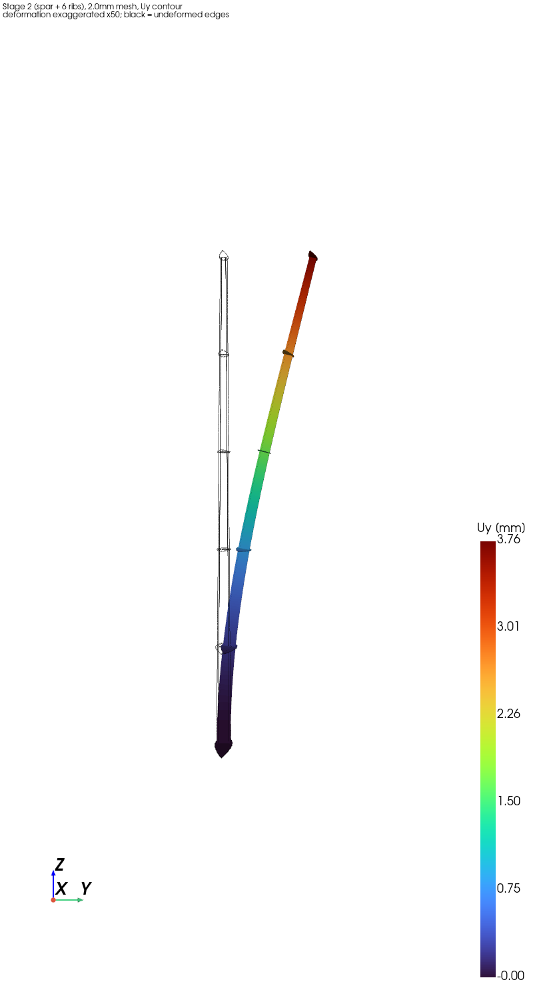

*Uy, deformation exaggerated x50, black = undeformed.*

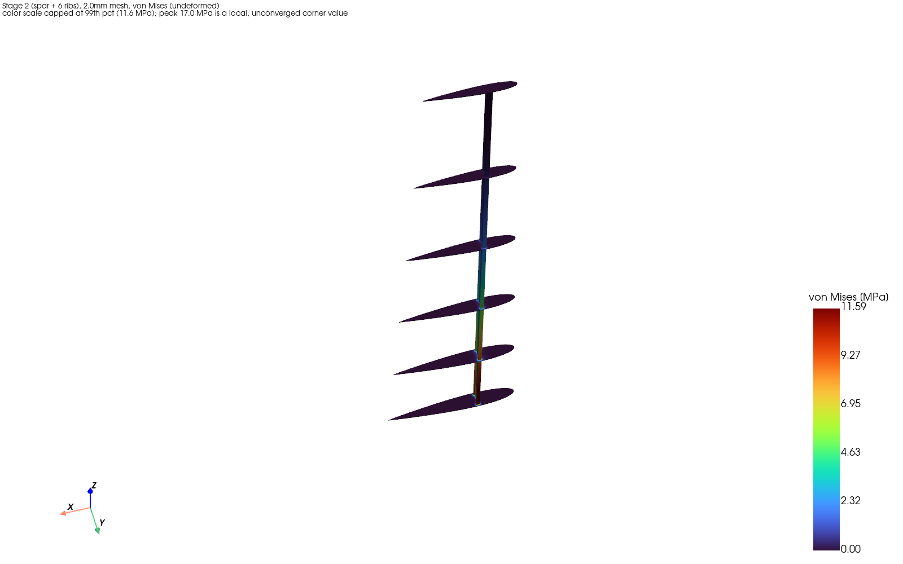

*von Mises, colour scale capped at the 99th percentile (11.6 MPa).*

**The ribs add weight, not bending stiffness:** the tip deflection fell
4.2% (3.841 to 3.679 mm), and the ribs' added self-weight alone
predicts 4.25%. The ribs cost +108 g (+49% mass) and add a small twist.
Their structural value has to come from the skin.

## Findings — Stage 3 (spar v2 + ribs + skin, limit load)

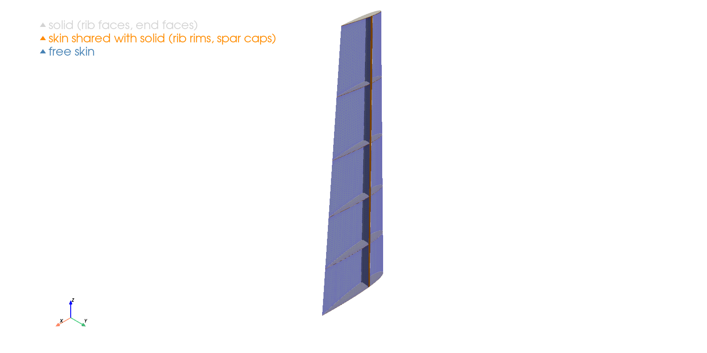

*Production mesh (t = 1.0 mm): free skin (blue), skin sharing nodes with
the solid (orange: rib rims and spar-cap strips), other solid faces
(grey).*

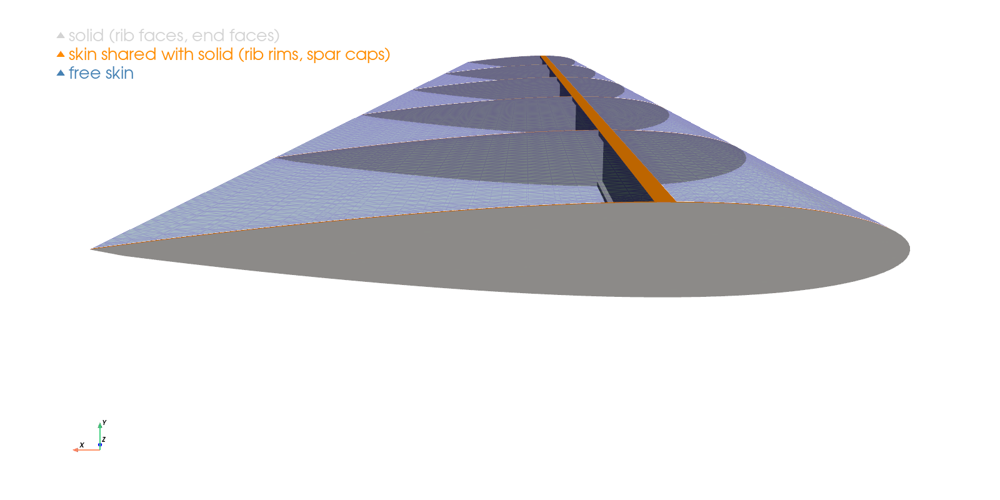

**Skin thickness study** (limit load n = 3.8, lift 372.78 N per
half-wing, 200 mm rib spacing, aircraft mass 20 kg assumed, yield
290 MPa assumed):

| Skin t | Skin mass | Tip deflection | Buckling factor (>= 1.5) | Design skin stress* | Result |
|---|---|---|---|---|---|
| 0.5 mm | 0.64 kg | 8.36 mm | 0.91 (6 mm skin mesh: 0.93) | 39.4 MPa | **fails** buckling |
| **1.0 mm** | 1.28 kg | 4.20 mm | **3.14** (6 mm: 3.12) | 34.2 MPa | **passes; locked** |
| 1.5 mm | 1.92 kg | 2.52 mm | 8.61 | 25.3 MPa | passes, 50% heavier |

*Maximum von Mises over skin nodes at least 3 mm from the trailing edge
and more than 10 mm from the fixed root (see the singularity finding
below); factors of safety against the assumed yield are about 7.4 / 8.5
/ 11.5. In Stage 4 the location of this maximum was examined: it
sits at the tip leading-edge node and next to the 3 mm trailing-edge
exclusion band, not in the bending field (skin p99 is about 18 MPa);
see Stage 4 below.

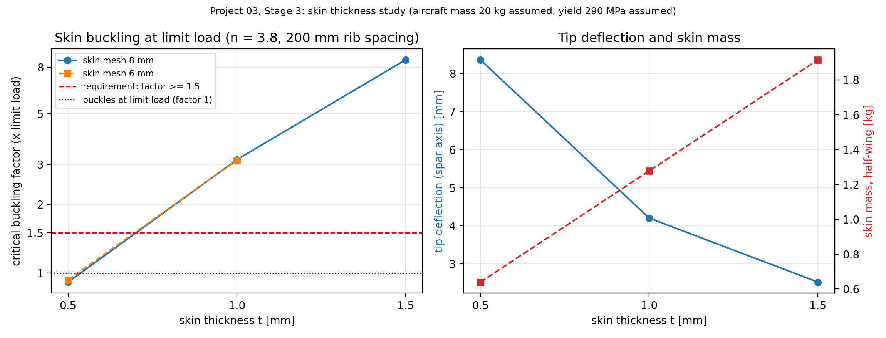

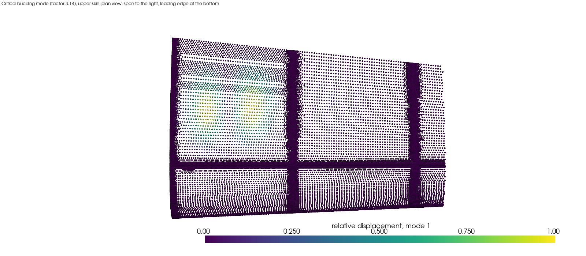

*Critical mode at t = 1.0 mm (factor 3.14): a single local buckle of the
upper skin aft of the spar in the root bay. All six computed modes, at
every thickness, are upper-skin, aft-of-spar, out-of-plane buckles in
the two root bays, none at the edges or at rib planes.*

**Verification and convergence (what was and was not shown):**
- Load application: results at the n = 1 and n = 3.8 load cases
  superpose exactly (lift x15.215 minus gravity x3.8 reproduces the
  limit-load tip deflection to four digits), and the effect of solid and
  skin gravity matches the beam model to 0.5% and 0.1%.
- Tip deflection vs. a tapered beam with a fully effective skin ring
  (an approximate reference, not a bound): +0.82% / -0.35% / -3.07% at
  0.5 / 1.0 / 1.5 mm; with a nearly absent skin (0.05 mm control) the
  model matches the spar-only beam to +0.15%.
- Mesh: solid 2.5 -> 4 mm changes the tip deflection by -0.02%; skin
  8 -> 6 mm changes the t = 1.0 mm buckling factor by -0.5% (and the
  0.5 mm factor by +2.2%), and the skin stress percentiles by under 2%.
- Buckling plausibility: the critical stress of the first mode (32.5 MPa)
  agrees with simply supported flat-plate theory for the buckle's own
  width (31.6 MPa) to 2.7% — a plausibility check, not a verification.

**Trailing-edge stress peak is a singularity of the model.** The
largest skin stress (238 MPa at t = 1.0 mm) sits at the trailing-edge
vertex at the ribs. Local refinement at one rib (median edge 2.1 to
0.28 mm) made the peak grow without bound (232 -> 536 MPa skin,
83 -> 473 MPa solid), while the stress farther than 3 mm from the
trailing edge converged (3-6 mm ring: 29.3 -> 35.7 MPa; 6-15 mm:
15.1 -> 19.3 MPa) and unrefined control ribs did not move. This peak is
excluded from the stress requirement; the true trailing-edge stress of a
real finite-thickness trailing edge is not predicted.

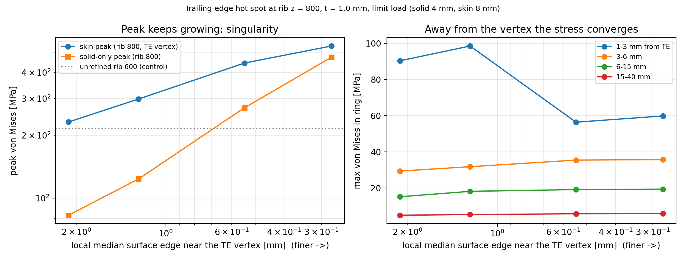

**Sensitivity to the assumed aircraft mass.** The analysis is linear, so
the buckling factor scales roughly as 1 / load: 0.5 mm would pass for an
aircraft of about 12 kg or less, 1.0 mm up to about 40 kg. The locked
thickness is valid for the 20 kg assumption only.

**Unresolved:** away from the root the skin stress and bending curvature
in the FEA are lower than the beam reference (stress ratio at
z = 700 mm: 0.88 / 0.74 / 0.58 at 0.5 / 1.0 / 1.5 mm; the tip deflection
agreement within 3% is partly a compensation with extra inboard
flexibility). A skin-free control agrees, so the cause is skin-related
and not found. Reaction-force output is not interpretable for CalculiX
expanded shells, so global equilibrium is checked indirectly (see the
development log).

## Findings — Stage 4 (lift distributed over the skin, limit load)

Stages 1-3 applied the half-wing lift as nodal forces on the spar's
top-cap face. Stage 4 applies the same limit-load lift (372.78 N per
half-wing at n = 3.8; aircraft mass 20 kg assumed) to the skin. **The
distribution is an analytic placeholder, not an aerodynamic prediction**;
CFD-derived pressure belongs to Project 04. Choices:

- Spanwise: elliptical, q(z) = q0 sqrt(1 - (z/1000)^2).
- Chordwise: thin-airfoil flat-plate loading, dCp proportional to
  sqrt((1 - xi)/xi) with xi from the leading edge. Its centre of pressure
  (25% chord) lies 5% chord ahead of the spar axis (30%), so the lift
  twists the wing.
- Split: antisymmetric, suction on the upper skin and pressure on the
  lower skin, each carrying half of the net lift.
- Implementation: consistent nodal forces on the S6 skin nodes, with the
  leading-edge singularity integrated exactly (means from exact
  antiderivatives over 64 sub-triangles per element), normalised to a net
  vertical force of 372.78 N. Gravity (x 3.8) is unchanged.

**Load checks before any solve** (recomputed independently from the
written input files): net Fy = 372.78 N (normalisation factor 1.00003);
root moment within 0.0002% of the elliptical value (158,213 N mm);
sum(Fy x) about the spar axis within 0.04% of the 25%-chord value;
chordwise centre of pressure 0.2493-0.2506 in every 100 mm span bin
(0.2495-0.2504 at the finer skin mesh); net horizontal residuals 0.04 N
(x) and 0.004 N (z). 95% of the load acts on shell-only nodes.

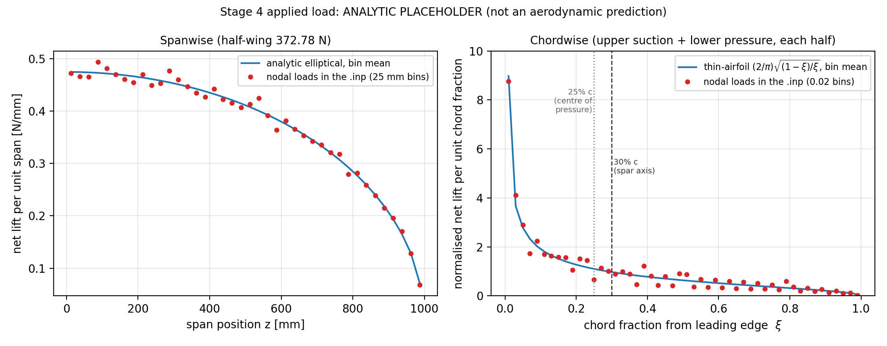

**Stage 3 (spar-cap load) against Stage 4 (skin pressure), t = 1.0 mm,
200 mm rib spacing** (4/8 = solid 4 mm / skin 8 mm; 4/6 = skin 6 mm):

| Quantity | S3 4/8 | S4 4/8 | S3 4/6 | S4 4/6 |
|---|---|---|---|---|
| Tip deflection, spar axis [mm] | 4.203 | 4.198 | 4.203 | 4.198 |
| Design skin stress* [MPa] | 32.9 | 32.1 | 32.8 | 32.1 |
| Skin p99 von Mises [MPa] | 18.7 | 18.5 | 18.3 | 18.2 |
| Critical buckling factor (>= 1.5) | 3.139 | 3.194 | 3.123 | 3.178 |
| Tip twist, nose-up [1e-4 rad] | 1.59 | 3.99 | 1.58 | 3.98 |

*Same definition as Stage 3 (at least 3 mm from the trailing edge, more
than 10 mm from the root); see below for where it occurs.

**Bending and stress.** Moving the load from the spar-cap face to the
skin changes the tip deflection by -0.12% and the design stress by -2.3%.
Local stress changes of about +-4 MPa appear on the skin next to rib 400
(plausible local panel bending under the pressure; not checked). The
design maximum sits at the tip leading-edge node (free skin edge at the
tip rib) and at nodes just outside the 3 mm trailing-edge band at the
ribs, not in the bending field (skin p99 about 18.5 MPa). Excluding the
tip end (z >= 995 mm) it is 29.3 / 29.7 MPa (Stage 3 / Stage 4); also
excluding distances below 6 mm from the trailing edge, 24.8 / 24.4 MPa
(cutoffs chosen after inspecting the data). Under every definition Stage 3
and Stage 4 agree within about 2%, and the factor of safety against the
assumed yield is about 9 (8.8 in Stage 3, 9.0 in Stage 4, official definition): stress does not govern at 1.0 mm.

**Buckling.** The critical factor rises from 3.14 to 3.19 (+1.75%; 3.12 to
3.18 on the finer skin mesh), against the requirement of 1.5. The mode is
unchanged in kind: a local out-of-plane buckle of the upper skin aft of
the spar in the first root bay (all six modes are upper-skin, none near
the edges or rib planes). The cause of the +1.75% was not isolated, and
the thickness lock stands.

**Twist (new in Stage 4).** The tip rotates nose-up by 0.023 degrees
(3.99e-4 rad): 2.50e-4 rad from the lift and 1.49e-4 rad from gravity
(presumably because the skin's centre of gravity lies aft of the spar
axis; not computed). A tip leading edge 45 mm ahead of the spar rises by
about 0.018 mm, 0.4% of the bending deflection: twist is not a design
driver here. Rotation is fitted from the rib-plane nodes (rms fit
residual <= 0.0073 mm; the ribs are not rigid).

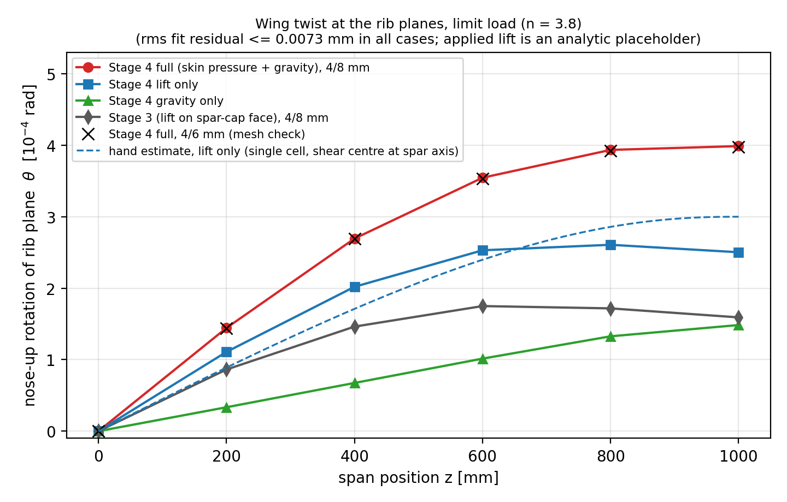

*Dashed: single-cell Bredt-Batho estimate with the shear centre assumed at
the spar axis (3.0e-4 rad at the tip for the lift). It is linear in the
assumed shear-centre offset, so it is a plausibility check only, not a
verification; hand/FEA ranges from 0.80 at z = 200 mm to 1.20 at the tip.*

**What was and was not shown.** Lift-only plus gravity-only reproduces the
full case to 1 nm in tip deflection (a consistency check of the linear
solutions). The lift-only tip deflection (5.132 mm) is within 0.12% of the
value inferred from the spar-cap-loaded model (5.138 mm), which shows
that the load placed on shell nodes is transmitted in vertical bending;
it does not verify the chordwise distribution or the antisymmetric
split. Skin refinement 8 to 6 mm changes the tip deflection by +0.003%,
the twist by -0.3%, the design stress by -0.02% and the buckling factor by
-0.5% (two mesh levels only).

## Findings — Stage 5 (rib spacing, reduced scope: 200 mm against 100 mm)

The study was specified for uniform rib spacings of 100, 50 and 20 mm against
the 200 mm baseline. On this machine (11 GB RAM) only 200 mm and 100 mm could
be solved at the validated mesh (solid 4 mm / skin 8 mm), so Stage 5 compares
those two. **The 50 mm and 20 mm cases were not run.**

- **50 mm (21 ribs):** geometry and mesh were built (112,518 tets + 65,800
  shells = 178,318 elements, 77.5% of the 230,000-element ceiling), but the
  equation estimate is 1.40 million, 118.7% of the 1.18 million ceiling that
  was set after a host crash in Project 01. A rough extrapolation from the
  Stage 3 solves gives about 9 GB for a static solve. Never solved.
- **20 mm (51 ribs):** geometry built, not meshed: the tets alone extrapolate
  to about 246,000 (three data points), above the element ceiling. The
  imprint also contains four sliver pieces (two of 0.0037 mm^2).
- The study will be extended after a RAM upgrade. The tooling is in place
  (`RIB_SPACING` environment variable in the geometry, imprint, mesh and
  input scripts). The 50 mm mesh needs `NETGEN_KW="closeedgefac=None"`: with
  Netgen's default close-edge refinement the 2D surface mesher fails and then
  spins on that geometry; at 200 mm and 100 mm the option gives
  array-for-array identical meshes.

Same load, thickness, material and ribs as before: the Stage 4 analytic
placeholder pressure at limit load (372.78 N per half-wing, n = 3.8; 20 kg
aircraft mass and 290 MPa yield assumed), skin 1.0 mm, solid ribs 1.5 mm thick
without lightening holes (uniform spacing, including the root and tip ribs).

| Quantity | 200 mm (6 ribs) | 100 mm (11 ribs) | Change |
|---|---|---|---|
| Total mass (solid + skin) | 1.635 kg | 1.723 kg | +5.4% |
| Tip deflection, full [mm] | 4.198 | 4.046 | -3.6% |
| Tip deflection, lift only / gravity only [mm] | 5.132 / -0.934 | 4.995 / -0.949 | -2.7% / +1.6% |
| Beam reference with rib-section inertia, full [mm] | 4.194 | 4.129 | |
| FEA against that beam | +0.09% | -2.0% | |
| Tip twist | 0.0228 deg | 0.0236 deg | +3.5% |
| Skin p99 von Mises | 18.5 MPa | 18.6 MPa | +0.4% |
| Design stress (dTE >= 3 mm)* | 32.1 MPa | 37.7 MPa | +17.5% |
| Variant (z < 990 mm, dTE >= 6 mm)** | 24.4 MPa | 25.1 MPa | +3.1% |
| **Critical buckling factor (>= 1.5)** | **3.19** | **3.91** | **+22.5%** |
| Buckling modes 1-6 | 3.19, 3.37, 4.35, 4.62, 4.79, 5.09 | 3.91, 4.33, 5.26, 5.50, 5.65, 5.98 | +17 to +29% |
| Elements (C3D10 + S6) / equation estimate | 79,597 / 660k | 114,078 / 921k | |
| Solve time, peak memory (static / buckling) | 93 s, 4.35 GB / 214 s, 4.73 GB | 134 s, 6.19 GB / 326 s, 6.71 GB | |

*Same definition as Stages 3 and 4; **mesh-sensitive, see below.
**chosen after inspecting the data (sensitivity probe, not a pre-set rule).

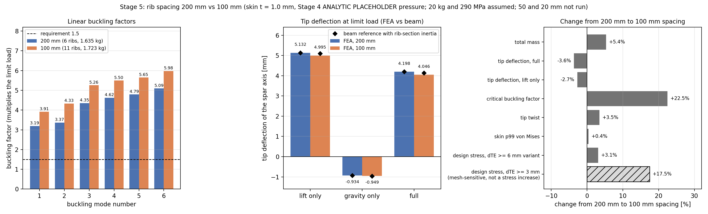

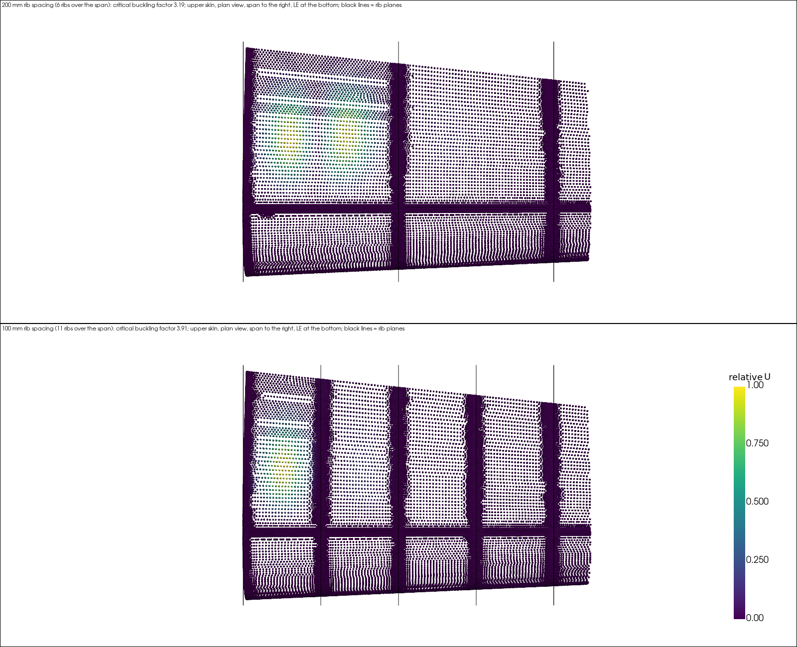

*Critical buckling mode (upper skin, plan view, span to the right, black lines
are rib planes): at 200 mm it fills the root bay; at 100 mm it is confined to
one bay.*

**Buckling.** The critical factor rises 22.5% (3.19 to 3.91), and every one of
the six computed modes rises (+17 to +29%). All modes remain local out-of-plane
buckles of the upper skin aft of the spar, none at the edges or at the rib
planes; at 100 mm all six lie in the first two bays (z < 200 mm). **This
contradicts my Stage 3 expectation**, a plate-theory estimate that denser ribs
would help only below about 93 mm spacing (and my prediction for this run of
3.1 to 3.5). The cause of the +22.5% was not isolated.

**Bending.** Of the -3.6% tip-deflection change, the lift-only solution
carries -2.7% and the gravity-only solution +1.6% in magnitude (a consistency
check: lift-only plus gravity-only reproduces the full case to a nanometre).
A beam reference that includes the rib-section inertia (the filled airfoil over
each rib's 1.5 mm) explains -0.6% of the lift response. At 200 mm that beam
agrees with the FEA to 0.1 to 0.2%; at 100 mm the FEA is 2% stiffer than it.
My interpretation (not tested) is that ribs 100 mm apart suppress section
distortion and shear lag in the skin, which a beam does not represent.

**Stress.** The field stress is unchanged (skin p99 +0.4%). The official
design-stress metric rises 17.5%, but its maximum sits at 3.1 mm from the
trailing-edge vertex at a rib (the edge of the exclusion band), where the
Stage 3 study showed a mesh-dependent singularity; the 100 mm mesh is finer
there and has more rib stations. The metric is therefore not comparable across
spacings, and the +17.5% is not a physical stress increase. The less
mesh-sensitive variant rises 3.1%. The factor of safety against the assumed
yield is at least 7.7 (official metric) or about 11.5 (variant), against a
requirement of 1.5: stress does not govern.

**Twist** rises slightly (+3.5%), which is the opposite of what more ribs would
suggest for torsion; not investigated.

**Cost against benefit.** The 87.9 g of extra ribs (+5.4% mass) buy +22.5%
buckling factor and -3.6% tip deflection. At t = 1.0 mm the buckling
requirement was already met by +109% at 200 mm, so the extra margin is not
needed at this thickness; whether denser ribs would allow a thinner skin was not
studied (the thickness stays at the locked 1.0 mm).

**What was and was not shown.** Shown: exact superposition of the solutions,
the pre-solve load gates, 0 warnings in all solves, a beam cross-check, and
mesh-quality statistics (median tet quality 0.82; at most 7 tets below 0.05 in
each mesh, all near the apex of the wedge feature at z of about 745 to 749 mm,
away from the reported hot spots). Not shown: any trend beyond two spacings (no
optimum can be named), skin-size or solid-size convergence at 100 mm (a 6 mm
skin is extrapolated to need about 7.7 GB for the static and about 8.2 GB for the buckling solve, at
or above the 8 GB watchdog limit; not tried), or the effect of the poorest tets.

## Limitations

- **Unsourced inputs:** aircraft mass (20 kg, my assumption), yield
  (290 MPa, uncited), and the load factor's primary source (STANAG 4671
  / CS-23 not retrieved). The thickness lock depends on the first two.
- Stage 3 results use the elliptical load on the spar's top-cap face;
  Stage 4 (above) replaces it by an analytic placeholder pressure on the
  skin. That pressure is not an aerodynamic prediction: the net lift is
  split equally between upper suction and lower pressure by assumption,
  and the nodal load follows the analytic chordwise distribution to 1.4%
  (maximum cumulative difference; 0.2% spanwise), limited near the
  leading edge by the 8 mm skin mesh.
- The Stage 4 load acts through nodal forces on shell nodes: they were
  checked through vertical bending (lift-only tip deflection within 0.12%
  of the spar-cap-loaded model, exact superposition), not independently
  for the chordwise or antisymmetric detail. In the linear buckling
  preload the forces are fixed-direction (not follower) loads.
- The twist reference is a hand estimate (single cell, shear centre
  assumed at the spar axis, ribs and web ignored); the FEA lift-only
  twist is 25% above it at z = 200 mm and 17% below it at the tip,
  and the difference is unexplained. The twist is small and not a
  design driver.
- The design skin stress is set by local locations (tip leading-edge
  node; band just outside the trailing-edge exclusion), not by the
  bending field; its absolute value should not be read as a field stress.
- The inherited asymmetric trailing-edge closure produces 46 skin
  elements (0.04% of the area, 4/8 mm mesh) whose outward normal points
  downward and which are treated as upper skin; their load is negligible.
- Stage 5 covers only two rib spacings (200 and 100 mm); the 50 and 20 mm
  cases were not run because of the RAM limit, so no trend or optimum can be
  stated. No skin-size or solid-size convergence was done at 100 mm.
- About 2% of the 100 mm bending stiffness beyond a rib-aware beam, and the
  small twist increase, are unexplained; the +22.5% buckling change was not
  traced to a mechanism.
- The "design stress (dTE >= 3 mm)" metric is mesh-sensitive (trailing-edge
  singularity tail) and is not comparable across spacings.
- Tet-quality tail (worst 0.03 on the mean-ratio metric, at most 7 tets below
  0.05) at the apex of the wedge feature (x of about -4 mm, z of about 745 to
  749 mm) in all meshes; its effect was not tested.
- The solid ribs have no lightening holes, which inflates the mass cost of
  extra ribs relative to a real wing.
- Shell rotations at shared nodes are not coupled to the solid (solid
  nodes have no rotational DOF): the skin is effectively hinged to the
  caps and rib rims. Expected to be conservative for buckling; not
  quantified.
- Linear eigenvalue buckling only: no imperfections or post-buckling.
- Trailing-edge geometry is idealized (asymmetric polyline closure, sharp
  junction at the ribs); the trailing-edge stress is a mesh-dependent
  singularity and is excluded. Refinement was done at one rib.
- Four thin wedge-shaped skin pieces (0.07% of the skin area) force
  triangle angles down to 0.18 degrees; accepted, effect not isolated.
- The skin-vs-beam stress and curvature discrepancy above is unexplained.
- Global equilibrium by reaction forces could not be evaluated for the
  shell model.
- Convergence is shown between two mesh levels per mesh parameter.
- Stages 1-2 results describe the old (80%-depth) spar and the 24.5 N
  placeholder load.
- Al 2024-T3 properties are literature values, not verified against a
  primary source. Spar position and dimensions are fixed project-wide.

## Conclusion

Stages 1-3 establish a verified solid-and-shell FEA pipeline and a
skin-thickness selection under a defined limit-load case. With 200 mm
rib spacing the lightest of the three candidate skins that meets both
the buckling requirement (factor 3.1 at 1.0 mm against 1.5) and the
stress requirement (factor of safety about 8 outside the trailing-edge
singularity) is 1.0 mm; 0.5 mm buckles below limit load. Skin buckling
is local (the aft panel between spar and trailing edge, about 93 mm
wide), so ribs closer than about that width, not the 200 mm baseline
spacing, are what the rib studies of Stages 5-6 will probe. The result
is conditional on the stated assumptions and carries the documented
unresolved items. See the development log for the full record,
including every error and retraction.

Stage 4 replaces the spar-cap lift by an analytic placeholder pressure on
the skin (elliptical span, thin-airfoil chord, antisymmetric). At the same
total lift and root moment it changes the tip deflection by -0.12%, the
design skin stress by -2.3% and the critical buckling factor by +1.75%
(3.14 to 3.19), and adds a small nose-up twist (0.023 degrees at the tip).
The 1.0 mm thickness lock is unchanged. These results describe the
placeholder load, not aerodynamic loading; aerodynamic pressure belongs to
Project 04.

Stage 5 compared uniform rib spacings of 200 and 100 mm (50 and 20 mm were not
run: RAM). Halving the spacing adds 5.4% mass and raises the critical buckling
factor by 22.5% (3.19 to 3.91), against a requirement that was already met at
1.0 mm; it lowers the tip deflection by 3.6%, leaves the field stress
unchanged, and raises the twist slightly. These results again describe the
placeholder load, and with two spacings they show no trend.
