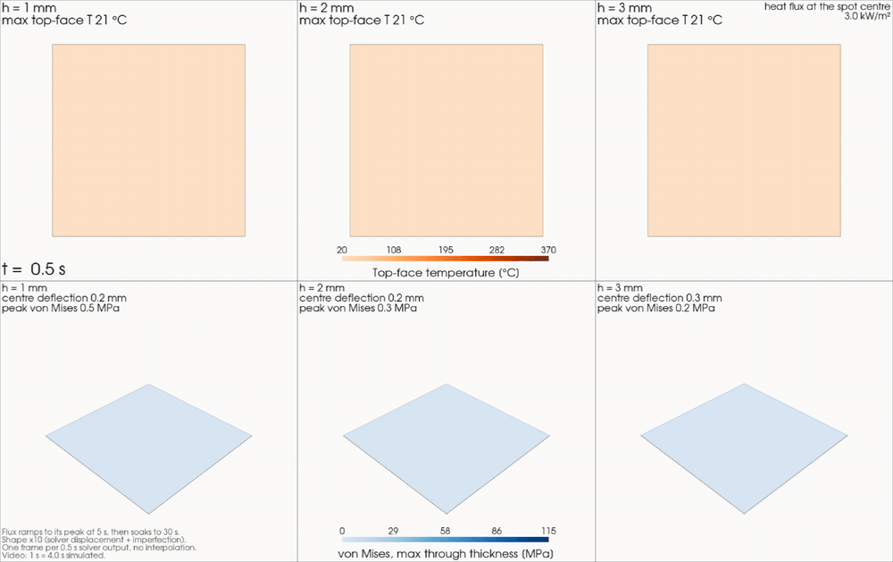
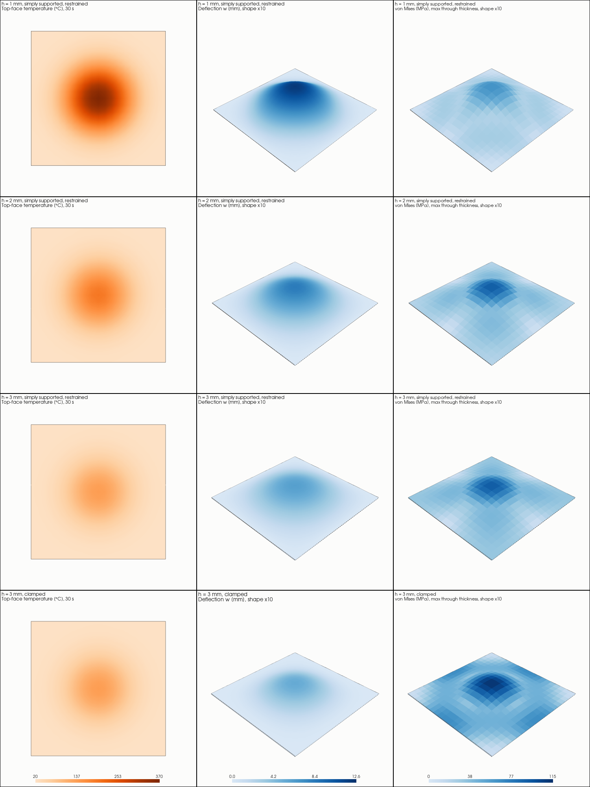

# 05 Thermo-structural aerospace panel

How does a thin titanium skin panel respond when part of it is heated and its edges are held by a cooler frame? This project builds a verified thermal-to-structural workflow in open-source tools (Gmsh, CalculiX 2.23, Python) and uses it to study how panel thickness and edge restraint control thermal stress and out-of-plane deformation.



*Top row: top-face temperature. Bottom row: von Mises stress on the deformed shape (deformation x10). Same heat flux on all three panels, 30 s, one frame per solver output. Full quality: [video_thickness_comparison.mp4](figures/video_thickness_comparison.mp4).*

## The problem

A 500 x 500 mm Ti-6Al-4V panel is heated on its top face by a Gaussian hot spot (30 kW/m2 peak, 5 s ramp, held to 30 s). Back face and edges are insulated. The edges are simply supported with in-plane restraint, as a stiff frame would hold them. Thickness is 1, 2 and 3 mm. The hot centre wants to expand, the cold surroundings and the frame prevent it, compressive stress builds up, and a thin panel buckles at a very small temperature rise.

Method: transient heat transfer, then a geometrically nonlinear static analysis with the temperature field as load and a small first-mode imperfection to select the buckled shape. Meshing, running, checking, post-processing and figures are all scripted.

## Results

Simply supported, in-plane restrained, imperfection +0.1 h, at t = 30 s:

| Thickness | Peak top-face temperature | Centre deflection | Peak von Mises stress |
|---|---|---|---|
| 1 mm | 369 C | 12.10 mm (12.1 h) | 62.9 MPa |
| 2 mm | 197 C | 8.33 mm (4.2 h) | 89.6 MPa |
| 3 mm | 140 C | 6.15 mm (2.0 h) | 91.0 MPa |

1. **All three panels are far past their buckling threshold.** The linear critical temperature rise is 0.57, 2.29 and 5.15 K for 1, 2 and 3 mm (finite-element values, verified against theory). The pulse produces rises of 349, 177 and 120 K. A linear analysis would be meaningless here; the nonlinear one carries the study.
2. **Peak stress is nearly the same at 2 and 3 mm** (89.6 and 91.0 MPa) and 30 % lower at 1 mm (62.9 MPa), while the deflection falls steadily with thickness (12.1, 8.3, 6.1 mm). The panel appears to relieve its compressive stress by bowing; this is a hypothesis, not tested here (bending and membrane stress were not separated).
3. **The highest stress is at the plate centre in the cold, insulated bottom layer**, in equibiaxial in-plane compression, not at the hot face and not at the edges.
4. **Edge condition matters only for the thick panel.** For the 1 and 2 mm panels, changing the in-plane edge condition (restrained, free, clamped) changes the centre deflection by up to 6.03 % and the peak stress by up to 1.81 %. At 3 mm, clamping raises the peak stress by 21 % (110.5 against 91.0 MPa) at the centre, and free edges reduce the deflection by 22 %.
5. **Stress is not the limiting quantity here.** The bounded von Mises stress is at most 140.1 MPa (3 mm clamped), 15.9 % of the room-temperature yield stress (880 MPa), across the 14 cases, while the 1 mm panel bows by about 2.4 % of its span. The factor of safety, bounded on that basis, lies between 6.3 and 11.1; it is not an allowable, because yield stress falls with temperature.



*1, 2 and 3 mm restrained and 3 mm clamped (rows); top-face temperature, deflection and von Mises stress (columns). Deformation x10.*

## What was verified

Every stage has a closed-form or internal reference with a tolerance fixed before the run. Failed attempts are kept on record in [docs/specification.md](docs/specification.md) (Amendments 1 to 16).

| Check | Reference | Result |
|---|---|---|
| 1D conduction through the thickness | linear profile | pass |
| Free thermal expansion | alpha dT L | error 1e-14 % |
| Restrained plate, central stress | -E alpha dT/(1 - nu) | 0.034 % (the first edge model failed at 1.4 % and was replaced) |
| Through-thickness gradient, free plate | alpha dT_g / h | 2.4e-4 % |
| Transient slab, constant flux | series solution | 0.108 %, first order in time |
| Linear buckling | critical temperature formula | -0.31 % (a thermal preload is not carried by the buckling step; a mechanical equivalent was used and verified) |
| Nonlinear post-buckling | single-mode reference curve | within 1.21 % (the first reference failed and was corrected; the verification runs were then blind) |
| Thermal step of the Gaussian pulse | energy balance, time step, symmetry | 0.00003 %, 0.43 %, exact |
| Temperature hand-over, thermal to structural | thermal history | 0.000 K at all 60 frames |
| Study, 14 cases | five per-case gates | 14 of 14 pass |

The structural results change by about 1 % when the in-plane mesh is refined from 20 x 20 to 40 x 40 (centre deflection 0.1 %, peak stress 0.9 %); the peak temperature changes by 1.3 to 1.4 % of the rise. Only two meshes were run, so no convergence order is claimed.

**This is verification, not validation.** No comparison with experimental or published panel data was made.

## Limitations

- Constant Ti-6Al-4V properties (typical vendor values). The 1 mm panel reaches about 370 C, beyond where constant properties are justified; the yield stress used for the factor of safety is the room-temperature value, so it is optimistic in the hot region.
- One-way coupling; no convection or radiation from the faces; one pulse shape; flat monolithic plate with an idealised frame; no stiffeners, curvature or fasteners.
- Single-mode imperfection. The -0.1 h case snaps through within one increment, which a quasi-static analysis cannot resolve, so its solution path is not claimed.
- Two element layers through the thickness; through-thickness refinement was not tested.
- The post-buckling reference is my own derivation, corrected once and then checked with blind runs; it has not been cross-checked against a published formula.
- A clean rerun of every stage was not part of the audit: the meshes, V1 to V4, V6 and the baseline regression gate were reproduced; the later stages have their own scripts but were not rerun from a fresh checkout.

## Reproduce

Environment: Ubuntu 24.04 (WSL2), Python 3.12, CalculiX 2.23 (conda environment `ccx223`), Gmsh Python API 4.15.2, NumPy, SciPy, Pandas, Matplotlib, PyVista, ffmpeg.

```bash
git clone git@github.com:hpanchal-aero/FEA-portfolio.git
cd FEA-portfolio/05-thermo-structural-panel

bash scripts/build_meshes.sh verify         # rebuild meshes and compare
bash scripts/run_early_verification.sh      # V1 to V4 and V6, about 45 s
/usr/bin/python3 scripts/run_case.py --h 2 --bc rest --imp 0.1 --regress   # baseline case
bash scripts/run_study.sh thickness         # case groups: thickness | imperfection | mesh
/usr/bin/python3 scripts/aggregate_study.py # results/study_summary.md
/usr/bin/python3 scripts/make_figures.py
```

Meshes and solver output are not stored in the repository; the scripts regenerate them. All case results are in `results/` (`study_summary.md`, `mesh_sensitivity.csv`, `cases/`).

## Contents
README.md
docs/specification.md specification, decisions, verification plan, Amendments 1 to 16
scripts/ meshing, case runner, verification, post-processing
verification/decks/ hand-written CalculiX decks for V1 to V4 and V6
results/ results of every stage and of the 14 study cases
figures/ figures and the video

## References

- Carslaw, H.S. and Jaeger, J.C., Conduction of Heat in Solids, 2nd ed., Oxford University Press, 1959.
- Timoshenko, S.P. and Gere, J.M., Theory of Elastic Stability, 2nd ed., McGraw-Hill, 1961.
- Celik, I.B. et al., Procedure for estimation and reporting of uncertainty due to discretization in CFD applications, J. Fluids Eng. 130(7), 078001, 2008.
- Dhondt, G., CalculiX CrunchiX User's Manual.
- Geuzaine, C. and Remacle, J.-F., Gmsh, Int. J. Numer. Meth. Eng. 79(11), 1309-1331, 2009.

